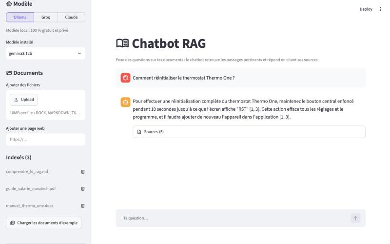
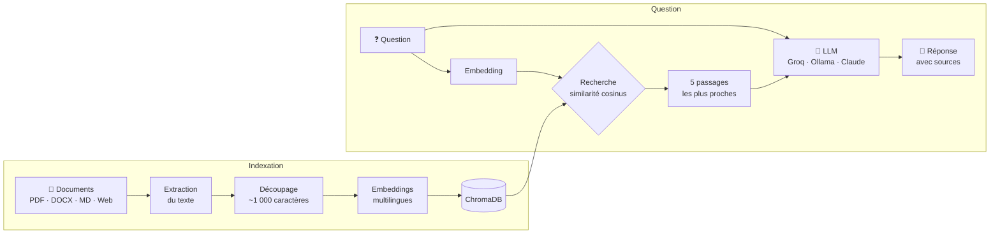

<div align="center">

# 📚 Chatbot RAG

**Pose des questions à tes documents (PDF, Word, Markdown, pages web) et obtiens des réponses sourcées.**

[](https://chatbot-rag-trbama.streamlit.app/)


[**Essayer la démo**](https://chatbot-rag-trbama.streamlit.app/) · [Fonctionnement](#-fonctionnement) · [Installation](#-installation-locale) · [Choix techniques](#-choix-techniques)



</div>

## ✨ Fonctionnalités

- **Multi-formats** : PDF (avec numéro de page), Word `.docx`, texte et Markdown, ou n'importe quelle page web à partir de son URL.
- **Réponses sourcées** : chaque réponse cite les passages utilisés (`[1]`, `[2]`…), consultables sous le message avec leur score de pertinence.
- **Honnête** : si l'information n'est pas dans les documents, le chatbot le dit au lieu d'inventer.
- **Trois moteurs au choix**, changeables en un clic :
  | Moteur | Coût | Pour quoi faire |
  |---|---|---|
  | **Groq** | Offre gratuite | Démo en ligne, réponses très rapides |
  | **Ollama** | 100 % gratuit | Usage local et privé, aucune donnée ne quitte la machine |
  | **Claude** | Payant à l'usage | Qualité maximale sur des documents complexes |
- **Recherche sémantique multilingue** : « vacances » retrouve un passage qui parle de « congés payés ».
- **Conversation suivie** : le chatbot tient compte des derniers échanges.
- **Démo prête à l'emploi** : trois documents d'exemple et des questions suggérées pour tester en un clic.

## 🧠 Fonctionnement

Le projet implémente un pipeline **RAG** (*Retrieval-Augmented Generation*) : plutôt que de répondre de mémoire, le modèle s'appuie sur les extraits de documents les plus pertinents.



1. **Extraction** du texte (`pypdf`, `python-docx`, `BeautifulSoup`), page par page pour les PDF.
2. **Découpage** en morceaux d'environ 1 000 caractères avec 200 caractères de chevauchement, en coupant de préférence en fin de phrase.
3. **Vectorisation** avec `paraphrase-multilingual-MiniLM-L12-v2` (via `fastembed`, exécuté localement en ONNX).
4. **Stockage** dans ChromaDB (sur disque en local, en mémoire et isolé par visiteur dans la démo).
5. **Recherche** des 5 passages les plus proches de la question.
6. **Génération** : les passages sont injectés dans la consigne du LLM, qui doit s'y limiter et citer ses sources.

## 🚀 Installation locale

Prérequis : Python 3.10 ou plus récent.

```bash
git clone https://github.com/T-R-Bama/chatbot-rag.git
cd chatbot-rag
python3 -m venv .venv
source .venv/bin/activate        # Windows : .venv\Scripts\activate
pip install -r requirements.txt
streamlit run app.py
```

Ouvre ensuite http://localhost:8501, puis clique sur **Charger les documents d'exemple** dans la barre latérale.

Il faut ensuite choisir un moteur :

<details>
<summary><b>Option 1 — Ollama (gratuit, local, privé)</b></summary>

1. Installe [Ollama](https://ollama.com/download) et lance-le.
2. Télécharge un modèle adapté à ta machine :

   | Mémoire (RAM) | Modèle | Taille |
   |---|---|---|
   | 8 Go | `ollama pull gemma3:4b` | ~3 Go |
   | 16 Go et plus | `ollama pull gemma3:12b` | ~8 Go |

3. Sélectionne **Ollama** dans la barre latérale.
</details>

<details>
<summary><b>Option 2 — Groq (gratuit, en ligne)</b></summary>

1. Crée une clé gratuite sur [console.groq.com/keys](https://console.groq.com/keys).
2. Copie `.streamlit/secrets.toml.example` en `.streamlit/secrets.toml` et colle ta clé (ou saisis-la directement dans la barre latérale).
</details>

<details>
<summary><b>Option 3 — Claude (payant)</b></summary>

Sélectionne **Claude** et colle une clé créée sur [console.anthropic.com](https://console.anthropic.com/settings/keys).
</details>

## ☁️ Déployer sa propre démo

1. Forke ce dépôt, puis crée une application sur [share.streamlit.io](https://share.streamlit.io) avec `app.py` comme fichier principal (Python 3.12).
2. Dans **Advanced settings → Secrets**, ajoute :
   ```toml
   GROQ_API_KEY = "gsk_..."
   DEMO_MODE = "true"
   ```

En mode démo, chaque visiteur dispose de sa propre base en mémoire, préremplie avec les exemples : les fichiers envoyés par un visiteur ne sont jamais visibles par les autres et disparaissent à la fin de sa session.

## 🛠 Choix techniques

| Besoin | Choix | Pourquoi |
|---|---|---|
| Interface | **Streamlit** | Chat, upload et streaming natifs ; déploiement gratuit sur Community Cloud |
| Embeddings | **fastembed** + MiniLM multilingue | Bon en français, gratuit, et sans PyTorch : l'installation pèse ~800 Mo de moins, ce qui permet de tenir dans les ressources gratuites de Streamlit Cloud |
| Base vectorielle | **ChromaDB** | Fonctionne sans serveur, persistante sur disque ou en mémoire |
| LLM | **Groq / Ollama / Claude** | Le même pipeline fonctionne avec un modèle cloud gratuit, local ou haut de gamme |
| Prompting | Passages balisés `<document>` numérotés | Facilite la citation des sources et limite les hallucinations |

## 📁 Structure du projet

```
chatbot-rag/
├── app.py                  # Interface Streamlit (chat, choix du moteur, documents)
├── rag/
│   ├── loaders.py          # Extraction du texte et découpage en morceaux
│   ├── store.py            # Embeddings et base vectorielle ChromaDB
│   └── llm.py              # Prompt et appels aux LLM (Groq, Ollama, Claude)
├── exemples/               # Documents d'exemple de la démo (fictifs)
├── .streamlit/             # Configuration et modèle de secrets
└── requirements.txt
```

## 🔭 Pistes d'amélioration

- Recherche hybride (sémantique + mots-clés BM25) et reclassement (*reranking*) des passages.
- Reformulation des questions de suivi (« et pour les cadres ? ») avant la recherche.
- OCR pour les PDF scannés et extraction des tableaux.
- Évaluation automatique de la qualité des réponses sur un jeu de questions de référence.

## 📄 Documents d'exemple

Les documents du dossier `exemples/` ont été créés pour cette démo : **NovaTech** et le thermostat **Thermo One** sont fictifs.

## 📝 Licence

Distribué sous licence MIT. Voir [LICENSE](LICENSE).
